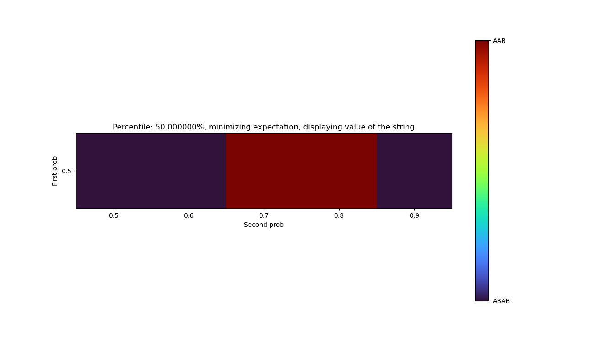
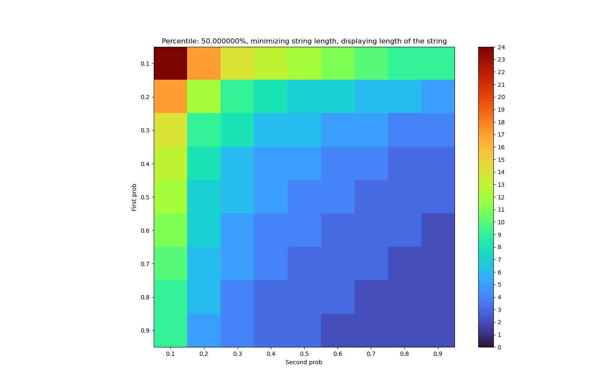
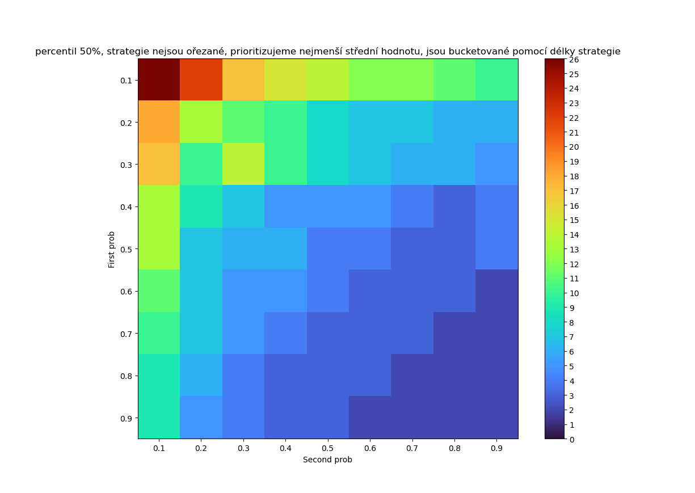

# Interesting examples

This file contains interesting examples found while creating this project.

## Example 1

For line like POMDP with 3 states and first move probability of $p=0.5$ and second move probability of $q=0.4$. When
trying to optimize strategy for reaching probability of at least $t=0.5$ of being in the final state. The optimal
strategies, when optimizing for number of moves that guarantee this and when optimizing the expected number of moves to
get there, have different lengths.

- When optimizing the length of strategy, the optimal strategy is: `ABABB`, with expectation of $3.88$
- When optimizing the expectation, the optimal strategy is: `ABBBAB`, with expectation of $3.81$

## Example 2

For line like POMDP with 3 states and first move probability of $p=0.5$ and second move probability being increased
from $q=0.5$ to $0.9$. When optimizing for expectation of being in final state with probability of at least $t=0.5$. The
optimal strategy changes as $p$ grows and then changes back as it grows more. For $q \in \{0.5,0.6\}$, tho optimal
strategy is `ABAB`. For $q \in \{0.7,0.8\}$ the optimal strategy is `AAB`. Lastly for $q = 0.9$, the optimal strategy is
again `ABAB`.

## Example 3

For line like POMDPs with three states, while trying to optimize strategy for reaching probability of at least $t=0.5$
of being in the final state. When optimizing the length of the strategy, the lengths are symmetric in move
probabilities $p,q$. This means that the minimal length for first move probability of $p$ and second move probability
of $q$ is the same as when the probabilities are swapped. On the other hand, when optimizing for expected number of
moves, it is not symmetrical.

*Lengths of strategies when optimizing for strategy length*

*Lengths of strategies when optimizing for expectation*