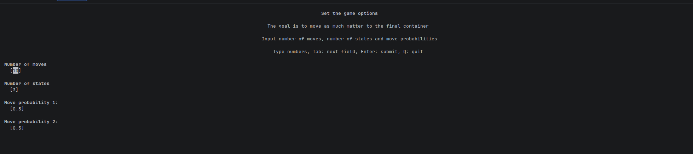

# User documentation

## Installation

### Dependencies

The following packages must be installed:

- `cmake`
- `make`
- C++ compiler
- `python3`
- `python3-dev`
- `python3Packages.matplotlib`
- `python3Packages.numpy`
- `python3Packages.pybind11`
- `python3Packages.blessed`

## Building the Project

```shell
source build.sh
```

# POMDP game

## Overview

POMDP game is a terminal user interface game that visualizes Partially Observable Markov Decision Processes (POMDPs).
Player moves matter between different containers, this represents the changes in belief about our current state.

Containers are numbered from `0`, to move matter from container `i` to container `i+1`, player must play action `i`.

There are two game modes:

- **Max Prob T Tries**: Maximize the amount of matter in the final container after a fixed number of moves
- **Min Moves Before Threshold**: Move a specified percentage of matter to the final container in as few moves as
  possible

First the player selects game mode, then configuration of the game mode and lastly gets to play the game. After
completing the objective of the game the player is revealed the optimal strategy.

## Running the Game

```shell
./run_game.sh
```

## Examples

**After running the game - game mode selection:**


**Configuration of the game mode:**



**Playing the game:**


**Game completed:**


## Game Flow

1. **Intro Screen**: Select which game mode to play
2. **Number Selection Screen**: Configure game parameters
3. **POMDP Game Screen**: Play the selected game

## Controls

### All Screens

| Key | Action        |
|-----|---------------|
| `Q` | Quit the game |

### Intro Screen

| Key             | Action                                    |
|-----------------|-------------------------------------------|
| `Arrow Up/Down` | Select game mode                          |
| `Enter`         | Confirm selection - move to config screen |

### Number Selection Screen

| Key         | Action                             |
|-------------|------------------------------------|
| `Tab`       | Move to next field                 |
| `Shift+Tab` | Move to previous field             |
| `Enter`     | Confirm selection - start the game |

### POMDP Game Screen

| Key     | Action                                  |
|---------|-----------------------------------------|
| `Enter` | Confirm action number - play the action |
| `R`     | Reset the current game                  |

## Game Modes

### Max Matter in Final Container After T Moves

**Objective:** Maximize the probability mass in the final state after exactly T moves.

**Configuration:**

- **Number of moves (T)**: How many the player can take (default: 10, max: 100)
- **Number of states**: Number of containers (default: 3, range: 3-5)
- **Move probabilities**: Probabilities of moving between states, what portion of matter to move between containers

**Game end:** Complete all T moves. The game shows how much matter you moved to the end and show the optimal solution.

### Min Number of Moves Before Threshold

**Objective:** Move a specified percentage of matter to the final state in as few moves as possible.

**Configuration:**

- **Amount of matter to move (M)**: The amount of matter needed to move to last container
- **Number of states**: Number of containers (default: 3, range: 3-5)
- **Move probabilities**: Probabilities of moving between states, what portion of matter to move between containers

**Game end:** Move at least M matter to last container. The game tells you how many moves you needed and shows you
optimal strategy.

